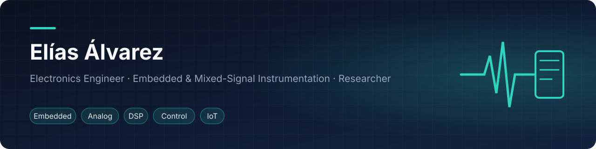
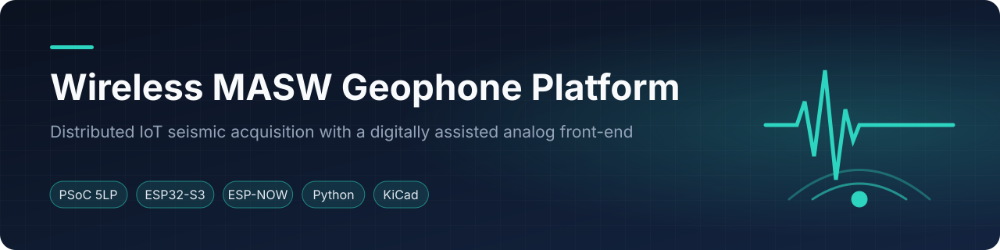
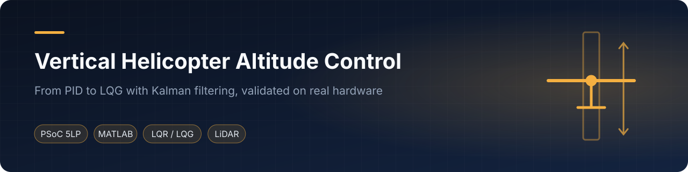
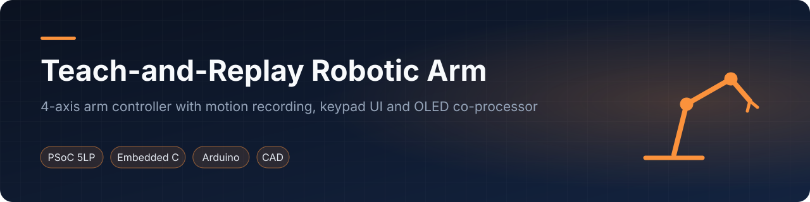
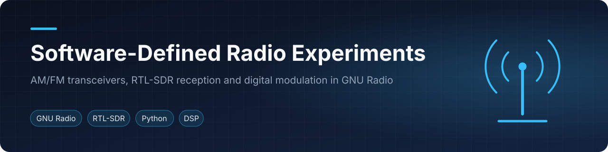
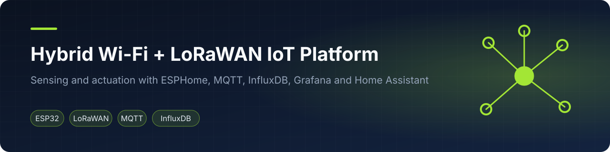
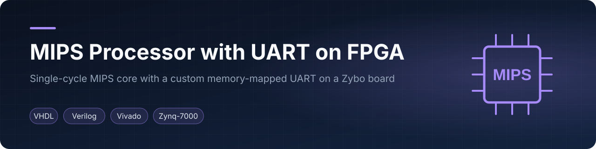
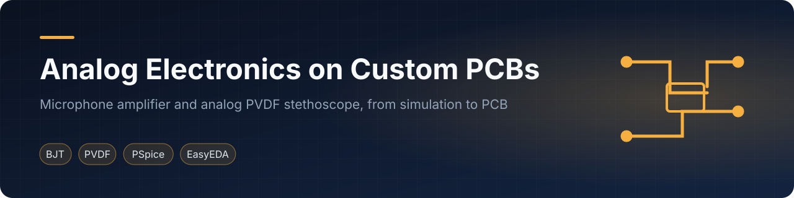

📍 Asunción, Paraguay · Spanish (native) · English (C1)

<a href="#english">English</a> · <a href="#español">Español</a>

---

## English

I design **embedded and mixed-signal systems that measure the physical world**: analog front-ends, data-acquisition firmware, wireless sensor networks, control loops and software for processing the resulting signals. I am a Junior Researcher and university lecturer at the Faculty of Science and Technology, Universidad Católica "Nuestra Señora de la Asunción" (FCT-UCA).

- **Research:** a wireless multichannel geophone platform for MASW soil characterization, with a digitally assisted analog front-end on PSoC 5LP (paper accepted at **IEEE URUCON 2026**).
- **3rd place (international), Quantum Hackathon LATAM 2025** (Open Quantum Institute · Microsoft · Universidad de Montevideo): *[Green Quantum Grids](https://github.com/Fac0810/Quantum-Hackathon-LATAM-2025-Grupo-8)* (team 8): quantum-assisted topology optimization of power grids to reduce transmission losses.
- **Teaching:** Programming Languages I, Automatic Control and Systems Architecture at FCT-UCA.

### Featured projects

<table>
<tr><td width="50%" valign="top"> Distributed seismic acquisition with a self-calibrating analog front-end. Residual offset cut from 2.9–45.8 % to 0.4–3.9 % of full scale. IEEE URUCON 2026.</td><td width="50%" valign="top"> Open-loop-unstable plant flown with PID, pole placement, LQR/LQI and LQG on a PSoC 5LP. <a href="https://www.youtube.com/watch?v=UubJcvpHcn4">Demo video</a>.</td></tr>
<tr><td width="50%" valign="top"> 4-axis arm that records and replays motions: knobs, keypad, LCD, EEPROM storage and an OLED co-processor.</td><td width="50%" valign="top"> Digital redesign of a stethoscope: real-time FIR filtering at 8 kHz for heart, lung and bowel sounds, plus FIR-vs-IIR studies.</td></tr>
<tr><td width="50%" valign="top"> AM/FM transceivers, an RTL-SDR broadcast receiver and digital modulation in GNU Radio. <a href="https://www.youtube.com/watch?v=J2AJL3caxe8">Videos</a>.</td><td width="50%" valign="top"> Wi-Fi and LoRaWAN nodes feeding one MQTT, InfluxDB, Grafana and Home Assistant backend.</td></tr>
<tr><td width="50%" valign="top"> MIPS core on a Zybo with a memory-mapped UART I designed: FIFOs, baud generator, status flags.</td><td width="50%" valign="top"> Fully analog PVDF stethoscope and a three-stage BJT microphone amplifier, from PSpice to fabricated PCBs.</td></tr>
</table>

On hold: [acoustic mosquito detection study](https://github.com/simplementeUnPorito/mosquito-acoustic-detection-study) (personal research, paused)

Also: [board games in C](https://github.com/simplementeUnPorito/c-board-games) · [LM35 multichannel thermometer](https://github.com/simplementeUnPorito/lm35-thermometer)

### Teaching
**[Teaching materials](https://github.com/simplementeUnPorito/teaching-materials)**: C programming exercises, a control-systems lab built around an analog reference plant (PID → optimal control), and computer-architecture exercises with MIPS pipeline animations.

### Experience
- **Junior Researcher**, Facultad de Ciencias y Tecnología, Universidad Católica (2025 – present): wireless seismic acquisition for MASW, digitally assisted analog front-ends.
- **University Lecturer**, same faculty (2026 – present): Programming Languages I, Automatic Control, Systems Architecture. Teaching assistant in Physics II (2022), Electromagnetism (2024) and Programming Languages I (2025 – 2026).
- **Junior Technician**, ANDE, national power utility (2019): graphical interfaces and data links for the SCADA monitoring system; repair of UPS units, industrial computers and electronic systems.
- **Systems maintenance intern**, Tape Ruvicha S.A.E.C.A. (2017): hardware and software troubleshooting.

### Awards
- 3rd place (international), Quantum Hackathon LATAM 2025: *Green Quantum Grids*.
- Gold medal, school science fair: Arduino-controlled robotic arm.
- Silver medal, National Student Physics Competition (2018).
- External evaluator, secondary-school science fair (2024).

### Publications
- **E. D. Álvarez, V. A. González, E. A. Vargas Cabral.** *Digitally Assisted Analog Front-End for Geophone Instrumentation.* IEEE URUCON 2026, Montevideo, Uruguay (accepted).
- **E. D. Álvarez, E. A. Vargas Cabral, V. A. González.** *Development and experimental evaluation of a distributed electronic platform for seismic acquisition oriented to MASW analysis.* XI Encuentro de Investigadores del Paraguay, 2026 (oral presentation).

### Toolbox
**Embedded:** PSoC 5LP · ESP32/ESP32-S3 (ESP-IDF, PlatformIO) · Arduino · ESP-NOW · I²C/SPI/UART · DMA  
**Analog & hardware:** instrumentation amplifiers · active filters · ADC/DAC front-ends · KiCad · JitX · EasyEDA · PSpice/OrCAD  
**Signals & control:** FIR/IIR design · SDR (GNU Radio) · Kalman filtering · PID · LQR/LQG · system identification · MASW / surface-wave analysis  
**Software:** C · C++ · Python (NumPy, SciPy, PyQt6, FastAPI) · MATLAB/Simulink · Verilog/VHDL · LaTeX  
**IoT & data:** MQTT · InfluxDB · Grafana · Home Assistant · LoRa/TTN · Git & Git LFS

### Education & training
- **Electronics Engineering** (thesis stage), Universidad Católica "Nuestra Señora de la Asunción", scholarship holder
- **Licentiate in Electronics**, Universidad Católica "Nuestra Señora de la Asunción" (2026)
- **Diploma in University Teaching**, Universidad Americana, 160 h (2026)
- **Industrial Technical Baccalaureate, Electronics emphasis**, Colegio Técnico y Centro de Entrenamiento Vocacional "Carlos Antonio López" (2017–2019): final project on process automation with robotics
- **ECI 2024, Universidad de Buenos Aires:** Deep Learning for Computer Vision · NeuroAI · LLMs
- **Hands-on Workshop on Network Security**, University of South Carolina (2026)

---

## Español

Diseño **sistemas embebidos y de señal mixta que miden el mundo físico**: frentes analógicos, firmware de adquisición, redes inalámbricas de sensores, lazos de control y software para procesar las señales obtenidas. Soy Investigador Júnior y docente universitario en la Facultad de Ciencias y Tecnología de la Universidad Católica "Nuestra Señora de la Asunción" (FCT-UCA).

- **Investigación:** plataforma inalámbrica multicanal de geófonos para caracterización de suelos por MASW, con un frente analógico asistido digitalmente en PSoC 5LP (artículo aceptado en **IEEE URUCON 2026**).
- **3.er puesto internacional, Quantum Hackathon LATAM 2025** (Open Quantum Institute · Microsoft · Universidad de Montevideo): *[Green Quantum Grids](https://github.com/Fac0810/Quantum-Hackathon-LATAM-2025-Grupo-8)*, optimización cuántica de la topología de redes eléctricas.
- **Docencia:** Lenguajes de Programación I, Controles Automáticos y Arquitectura de Sistemas en la FCT-UCA.

La sección en inglés contiene los proyectos destacados, las publicaciones y las herramientas. Cada repositorio tiene documentación en inglés y en español.
